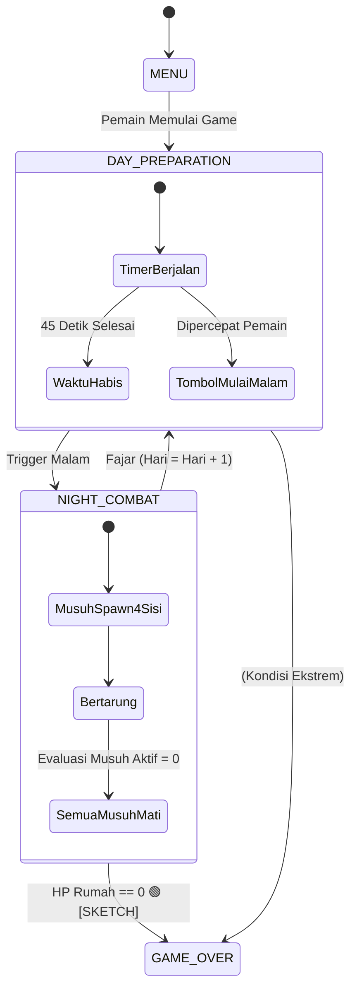

# 📐 TRD-001: Core Event Bus, Constants, & Game Manager

> **Technical Reference Document (TRD) - Modul Inti & Autoload**  
> ID Modul: **TRD-001**  
> Sumber Kebenaran: 🟢 **[SKETCH: Core Loop, Endless]**, 📘 **[PRD: 4.2, 11.2, 11.5]**, 🔵 **[TEKNIS GODOT]**  
> Penanggung Jawab: **Programmer 1**

---

## 1. Deskripsi Modul & Lingkup Kerja

Modul ini bertanggung jawab atas fondasi eksekusi runtime game:
1. Mendefinisikan enumerasi global (`PlantRole`, `Rarity`, `AttackType`, `GamePhase`, dll.) yang menjadi kontrak lintas modul.
2. Menyediakan saluran komunikasi decoupled melalui `EventBus` berbasis sinyal statis GDScript.
3. Mengatur siklus hidup game (Core Loop: Siang Persiapan ➔ Malam Serangan ➔ Evaluasi Fajar ➔ Endless Scaling) serta deteksi Game Over melalui `GameManager`.

---

## 2. Kebutuhan Teknis Godot 🔵 [TEKNIS GODOT]

### 2.1 Autoload Registration (`project.godot`)
Tiga script berikut wajib didaftarkan sebagai Autoload Global Singleton di Godot:
1. `Constants` ➔ `res://src/core/constants.gd`
2. `EventBus` ➔ `res://src/core/event_bus.gd`
3. `GameManager` ➔ `res://src/core/game_manager.gd`

### 2.2 Diagram Alur Siklus Hari (State Machine) 📘 [PRD: 4.2]



---

## 3. Spesifikasi Enumerasi & Konstanta Global 🔵 [TEKNIS GODOT]

File: `res://src/core/constants.gd`

```gdscript
class_name Constants
extends Node

# 🟢 [SKETCH: Tanaman Role] - Tepat 3 role eksklusif
enum PlantRole {
	DAMAGE_DEALER,
	SUPPORTER,
	DEFENDER
}

# 🟢 [SKETCH: Rarity] & 📘 [PRD: 5.2]
enum Rarity {
	COMMON,
	RARE,
	EPIC,
	LEGENDARY
}

# 🟢 [SKETCH: Hewan Tipe Serangan]
enum AttackType {
	MELEE,
	RANGED,
	NON_ATTACKING
}

# 🟢 [SKETCH: Arah Serangan 4 Sisi]
enum SpawnSide {
	NORTH_EAST,
	SOUTH_EAST,
	SOUTH_WEST,
	NORTH_WEST
}

# 📘 [PRD: 6.1] - Jenis modifikasi stat
enum EffectKind {
	BUFF,
	DEBUFF,
	CROWD_CONTROL
}

# 🟢 [SKETCH: CC Defender] & 📘 [PRD: 6.1]
enum CrowdControlType {
	STUN,
	SLOW,
	ROOT,
	BLOCK,
	KNOCKBACK,
	TAUNT
}

# 📘 [PRD: 9.1] - Tahapan status permainan
enum GamePhase {
	MENU,
	DAY,
	NIGHT,
	PAUSED,
	GAME_OVER
}

# ⚙️ [REKAYASA DESAIN] - Batasan parameter global
const MAX_HOUSE_LEVEL: int = 10
const MIN_DAMAGE_DEALER_DPS: float = 1.0 # 🟢 [SKETCH: Damage Dealer min 1 DPS]
const DAY_DURATION_SECONDS: float = 45.0 # ⚙️ [REKAYASA DESAIN: Durasi siang]

# 🔵 [TEKNIS GODOT] - Layer Collision Physics 2D
const LAYER_HOUSE: int = 1
const LAYER_PLANTS: int = 2
const LAYER_ENEMIES: int = 3
const LAYER_PROJECTILES: int = 4
const LAYER_COLLECTIBLES: int = 5
```

---

## 4. Spesifikasi EventBus (Sinyal Global) 🔵 [TEKNIS GODOT]

File: `res://src/core/event_bus.gd`

```gdscript
extends Node

# --- Alur Siklus Game ---
signal game_phase_changed(old_phase: Constants.GamePhase, new_phase: Constants.GamePhase)
signal day_started(day_number: int)
signal night_started(day_number: int)
signal night_ended(day_number: int)
signal game_over(days_survived: int)

# --- Ekonomi & Sumber Daya ---
signal resource_changed(current_balance: int, delta: int)
signal enemy_killed(reward_amount: int, enemy_id: StringName, death_position: Vector2)

# --- Entitas Rumah ---
signal house_health_changed(current_hp: float, max_hp: float)
signal house_upgraded(new_level: int, new_plant_space: int, max_plant_level: int)
signal house_destroyed()

# --- Entitas Tanaman ---
signal plant_placement_requested(plant_id: StringName, grid_cell: Vector2i)
signal plant_placed(plant_id: StringName, grid_cell: Vector2i, instance: Node2D)
signal plant_removed(grid_cell: Vector2i)
signal plant_upgraded(grid_cell: Vector2i, new_level: int)
signal plant_health_changed(grid_cell: Vector2i, current_hp: float, max_hp: float)

# --- Gelombang & Musuh ---
signal wave_spawn_started(day_number: int, total_enemies: int)
signal enemy_spawned(enemy_node: Node2D, side: Constants.SpawnSide)
signal enemy_count_changed(remaining_enemies: int)
```

---

## 5. Spesifikasi Logika GameManager 🔵 [TEKNIS GODOT]

File: `res://src/core/game_manager.gd`

```gdscript
extends Node

@export var day_duration: float = Constants.DAY_DURATION_SECONDS

var current_phase: Constants.GamePhase = Constants.GamePhase.MENU
var current_day: int = 1
var day_timer: float = 0.0
var active_enemy_count: int = 0
var days_survived: int = 0

func _ready() -> void:
	EventBus.enemy_spawned.connect(_on_enemy_spawned)
	EventBus.enemy_killed.connect(_on_enemy_killed)
	EventBus.house_destroyed.connect(_on_house_destroyed)

func _process(delta: float) -> void:
	if current_phase == Constants.GamePhase.DAY:
		day_timer -= delta
		if day_timer <= 0.0:
			start_night()

func start_new_game() -> void:
	current_day = 1
	days_survived = 0
	active_enemy_count = 0
	_set_phase(Constants.GamePhase.DAY)
	day_timer = day_duration
	EventBus.day_started.emit(current_day)

func fast_forward_day() -> void:
	if current_phase == Constants.GamePhase.DAY:
		day_timer = 0.0
		start_night()

func start_night() -> void:
	_set_phase(Constants.GamePhase.NIGHT)
	EventBus.night_started.emit(current_day)

func end_night() -> void:
	days_survived = current_day
	EventBus.night_ended.emit(current_day)
	current_day += 1
	day_timer = day_duration
	_set_phase(Constants.GamePhase.DAY)
	EventBus.day_started.emit(current_day)

func _set_phase(new_phase: Constants.GamePhase) -> void:
	var old_phase: Constants.GamePhase = current_phase
	current_phase = new_phase
	EventBus.game_phase_changed.emit(old_phase, new_phase)

func _on_enemy_spawned(_enemy_node: Node2D, _side: Constants.SpawnSide) -> void:
	active_enemy_count += 1
	EventBus.enemy_count_changed.emit(active_enemy_count)

func _on_enemy_killed(_reward: int, _id: StringName, _pos: Vector2) -> void:
	active_enemy_count = max(0, active_enemy_count - 1)
	EventBus.enemy_count_changed.emit(active_enemy_count)
	
	# Syarat selesai malam: semua musuh gelombang telah dimusnahkan 📘 [PRD: 4.2]
	if current_phase == Constants.GamePhase.NIGHT and active_enemy_count == 0:
		end_night()

func _on_house_destroyed() -> void:
	_set_phase(Constants.GamePhase.GAME_OVER)
	EventBus.game_over.emit(days_survived)
```

---

## 6. Pengujian Unit & Integritas Modul (QA Checklist)

- [ ] **T-CORE-01**: Panggilan `start_new_game()` mengubah fase ke `DAY`, mereset `current_day = 1`, dan memancarkan sinyal `day_started(1)`.
- [ ] **T-CORE-02**: Tombol "Mulai Malam" (`fast_forward_day()`) memotong sisa waktu siang dan langsung memancarkan `night_started`.
- [ ] **T-CORE-03**: Saat malam berjalan, `end_night()` **hanya terpanggil** jika `active_enemy_count == 0`.
- [ ] **T-CORE-04**: Sinyal `house_destroyed` langsung memaksa transisi ke state `GAME_OVER` dan memancarkan `game_over(days_survived)`.
