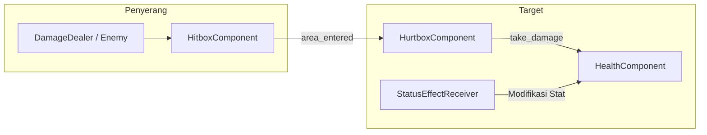

# 📐 TRD-005: Combat & Status Effect Components

> **Technical Reference Document (TRD) - Komponen Modular Tempur & Efek Status**  
> ID Modul: **TRD-005**  
> Sumber Kebenaran: 🟢 **[SKETCH: Aturan Role R1, R2, R3, R4, R5]**, 📘 **[PRD: 6.1, 11.4]**, ⚙️ **[REKAYASA DESAIN: Formula Stat Modifier Stack]**, 🔵 **[TEKNIS GODOT]**  
> Penanggung Jawab: **Programmer 2**

---

## 1. Deskripsi Modul & Lingkup Kerja

Modul ini adalah jantung mekanik tempur berbasis Entity-Component System (ECS) ringan di Godot:
1. `HealthComponent`: Mengelola nyawa, penerimaan damage, healing, serta kematian entitas.
2. `HitboxComponent` & `HurtboxComponent`: Mengatur kontak fisik/proyektil dan menegakkan **Aturan R2** (Hanya Damage Dealer yang boleh mengurangi HP musuh).
3. `StatusEffectReceiver`: Mengelola tumpukan Buff, Debuff, dan Crowd Control (CC), serta menegakkan:
   - **Aturan R3**: Hanya Supporter yang boleh memberi Buff/Debuff.
   - **Aturan R4**: Hanya Defender yang boleh melakukan CC.
   - **Aturan R5**: Rumah menolak mutlak segala bentuk Debuff.

---

## 2. Diagram Interaksi Komponen 🔵 [TEKNIS GODOT]



---

## 3. Implementasi `HealthComponent` 🔵 [TEKNIS GODOT]

File: `res://src/components/health_component.gd`

```gdscript
class_name HealthComponent
extends Node

signal health_changed(current_hp: float, max_hp: float)
signal damaged(amount: float, source_role: Constants.PlantRole)
signal healed(amount: float)
signal died()

@export var max_health: float = 100.0
@export var can_receive_debuff: bool = true # Diatur FALSE khusus untuk Rumah 🟢 [SKETCH: R5]

var current_health: float = 100.0
var is_dead: bool = false

func _ready() -> void:
	current_health = max_health

func set_max_health(new_max: float) -> void:
	max_health = max(1.0, new_max)
	current_health = min(current_health, max_health)
	health_changed.emit(current_health, max_health)

func heal(amount: float) -> void:
	if is_dead or amount <= 0.0:
		return
	current_health = min(max_health, current_health + amount)
	healed.emit(amount)
	health_changed.emit(current_health, max_health)

func take_damage(amount: float, source_role: int = -1, is_from_plant: bool = false) -> void:
	if is_dead or amount <= 0.0:
		return
		
	# 🟢 [SKETCH: Aturan R2] - Validasi Mutlak: Jika damage berasal dari tanaman ke musuh,
	# role tanaman penyerang WAJIB berupa DAMAGE_DEALER!
	if is_from_plant:
		assert(source_role == Constants.PlantRole.DAMAGE_DEALER, \
			"PELANGGARAN R2: Tanaman non-Damage Dealer mencoba memberi damage ke musuh!")
		if source_role != Constants.PlantRole.DAMAGE_DEALER:
			return # Blokir damage jika lolos build release
			
	current_health = max(0.0, current_health - amount)
	damaged.emit(amount, source_role)
	health_changed.emit(current_health, max_health)
	
	if current_health <= 0.0:
		is_dead = true
		died.emit()
```

---

## 4. Implementasi `HitboxComponent` & `HurtboxComponent` 🔵 [TEKNIS GODOT]

### 4.1 Hitbox Component
File: `res://src/components/hitbox_component.gd`

```gdscript
class_name HitboxComponent
extends Area2D

@export var damage: float = 10.0
@export var is_plant_source: bool = false
@export var plant_role: Constants.PlantRole = Constants.PlantRole.DAMAGE_DEALER

func _ready() -> void:
	area_entered.connect(_on_area_entered)

func _on_area_entered(area: Area2D) -> void:
	if area is HurtboxComponent:
		area.receive_hit(damage, plant_role, is_plant_source)
```

### 4.2 Hurtbox Component
File: `res://src/components/hurtbox_component.gd`

```gdscript
class_name HurtboxComponent
extends Area2D

@export var health_component: HealthComponent

func receive_hit(dmg: float, source_role: int, is_plant_source: bool) -> void:
	if health_component:
		health_component.take_damage(dmg, source_role, is_plant_source)
```

---

## 5. Implementasi `StatusEffectReceiver` 🔵 [TEKNIS GODOT]

File: `res://src/components/status_effect_receiver.gd`

```gdscript
class_name StatusEffectReceiver
extends Node

signal modifier_applied(mod_id: StringName, is_debuff: bool)
signal modifier_expired(mod_id: StringName)
signal cc_applied(cc_type: Constants.CrowdControlType, duration: float)
signal cc_expired(cc_type: Constants.CrowdControlType)

@export var can_receive_debuff: bool = true # 🟢 [SKETCH: R5 - Rumah bernilai false]

class ActiveModifier:
	var id: StringName
	var stat_name: String
	var is_percent: bool
	var value: float
	var time_left: float
	var is_debuff: bool
	var source_role: Constants.PlantRole

var modifiers: Array[ActiveModifier] = []
var active_crowd_controls: Dictionary = {} # cc_type -> time_left

func _process(delta: float) -> void:
	_update_modifiers(delta)
	_update_crowd_controls(delta)

# 🟢 [SKETCH: R3 & R5] Menerapkan Buff atau Debuff
func apply_modifier(
	mod_id: StringName, 
	stat_name: String, 
	is_percent: bool, 
	value: float, 
	duration: float, 
	is_debuff: bool, 
	source_role: Constants.PlantRole
) -> bool:
	# Aturan R5: Rumah menolak mutlak debuff
	if is_debuff and not can_receive_debuff:
		return false
		
	# Aturan R3: Hanya Supporter yang boleh memberi Buff/Debuff tanaman
	if source_role != Constants.PlantRole.SUPPORTER:
		push_error("PELANGGARAN R3: Non-Supporter mencoba memberi buff/debuff!")
		return false

	# Cek apakah modifier sejenis sudah aktif -> refresh durasi
	for mod in modifiers:
		if mod.id == mod_id:
			mod.time_left = duration
			return true

	var new_mod := ActiveModifier.new()
	new_mod.id = mod_id
	new_mod.stat_name = stat_name
	new_mod.is_percent = is_percent
	new_mod.value = value
	new_mod.time_left = duration
	new_mod.is_debuff = is_debuff
	new_mod.source_role = source_role
	modifiers.append(new_mod)
	
	modifier_applied.emit(mod_id, is_debuff)
	return true

# 🟢 [SKETCH: R4] Menerapkan Crowd Control
func apply_cc(cc_type: Constants.CrowdControlType, duration: float, source_role: Constants.PlantRole) -> bool:
	# Aturan R4: Hanya Defender yang boleh melakukan CC
	if source_role != Constants.PlantRole.DEFENDER:
		push_error("PELANGGARAN R4: Non-Defender mencoba menerapkan Crowd Control!")
		return false
		
	active_crowd_controls[cc_type] = max(active_crowd_controls.get(cc_type, 0.0), duration)
	cc_applied.emit(cc_type, duration)
	return true

func is_under_cc(cc_type: Constants.CrowdControlType) -> bool:
	return active_crowd_controls.has(cc_type) and active_crowd_controls[cc_type] > 0.0

# ⚙️ [REKAYASA DESAIN] Perhitungan Nilai Akhir Stat
func calculate_stat(stat_name: String, base_value: float, min_floor: float = 0.0) -> float:
	var flat_sum: float = 0.0
	var percent_sum: float = 0.0
	
	for mod in modifiers:
		if mod.stat_name == stat_name:
			if mod.is_percent:
				percent_sum += mod.value
			else:
				flat_sum += mod.value
				
	var final_val: float = (base_value + flat_sum) * (1.0 + percent_sum)
	return max(min_floor, final_val)

func _update_modifiers(delta: float) -> void:
	var expired: Array[ActiveModifier] = []
	for mod in modifiers:
		if mod.time_left > 0.0:
			mod.time_left -= delta
			if mod.time_left <= 0.0:
				expired.append(mod)
				
	for exp in expired:
		modifiers.erase(exp)
		modifier_expired.emit(exp.id)

func _update_crowd_controls(delta: float) -> void:
	var to_remove: Array[int] = []
	for cc_key in active_crowd_controls.keys():
		active_crowd_controls[cc_key] -= delta
		if active_crowd_controls[cc_key] <= 0.0:
			to_remove.append(cc_key)
			
	for rem in to_remove:
		active_crowd_controls.erase(rem)
		cc_expired.emit(rem as Constants.CrowdControlType)
```

---

## 6. Matriks QA & Kriteria Penerimaan

- [ ] **T-COMBAT-01 (Uji R2)**: Menembak musuh menggunakan entitas ber-role `SUPPORTER` atau `DEFENDER` memicu assertion error di debug dan diabaikan di release (HP musuh tidak berkurang).
- [ ] **T-COMBAT-02 (Uji R3)**: Tanaman dengan role selain `SUPPORTER` ditolak saat memanggil `apply_modifier()`.
- [ ] **T-COMBAT-03 (Uji R4)**: Tanaman dengan role selain `DEFENDER` ditolak saat memanggil `apply_cc()`.
- [ ] **T-COMBAT-04 (Uji R5)**: Rumah dengan `can_receive_debuff = false` selalu menolak modifier bertanda `is_debuff = true`.
- [ ] **T-COMBAT-05 (Formula Stat)**: Nilai DPS dasar 10 dengan buff +2 flat dan buff +20% menghasilkan $(10 + 2) \times 1.20 = 14.4$ konstan.
