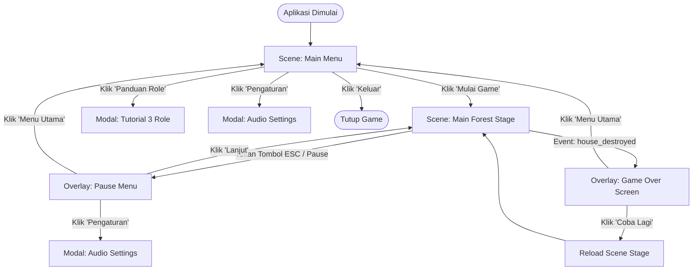

# 📐 TRD-014: Sistem Menu (Main Menu, Pause, Game Over & Panduan Role)

> **Technical Reference Document (TRD) - Sistem Menu, Pause, Game Over & Navigasi Layar**  
> ID Modul: **TRD-014**  
> Sumber Kebenaran: 🟢 **[SKETCH: 3 Role Tanaman]**, 📘 **[PRD: 4.2, 8.3, 9.7 (FR-UI-04)]**, ⚙️ **[REKAYASA DESAIN: Alur Navigasi, Persistent Highscore, Audio Settings]**, 🔵 **[TEKNIS GODOT]**  
> Penanggung Jawab: **Programmer 3 & Designer 1**

---

## 1. Deskripsi Modul & Lingkup Kerja

Modul ini bertanggung jawab atas seluruh navigasi antarmuka di luar siklus pertempuran aktif (out-of-combat UI) sesuai amanat **[PRD: 8.3 Layar Lain]** dan kriteria **FR-UI-04**:
1. **Main Menu (`main_menu.tscn`)**: Pintu masuk utama permainan yang memuat judul game (*Forest Defense*), tombol *Mulai Game*, *Tutorial/Cara Bermain*, *Pengaturan Suara*, dan *Keluar*.
2. **Modal Tutorial/Panduan Role (`tutorial_modal.tscn`)**: Layar singkat edukasi pemain yang memvisualisasikan 3 Role eksklusif (Damage Dealer, Supporter, Defender) sesuai aturan 🟢 **[SKETCH]** dan mekanik dasar pertahanan Rumah.
3. **Pause Menu (`pause_menu.tscn`)**: Lapisan popup (*overlay*) yang membekukan waktu permainan (`get_tree().paused = true`), memungkinkan pengaturan audio, serta opsi melanjutkan atau kembali ke Menu Utama.
4. **Game Over Screen (`game_over_screen.tscn`)**: Layar evaluasi akhir sesi saat Rumah hancur, menyajikan rekap hari bertahan, komparasi rekor tertinggi (*High Score*), tombol *Coba Lagi*, dan tombol *Kembali ke Menu Utama*.
5. **High Score Persistence**: Sistem penyimpanan lokal ringan (`user://save_data.json`) untuk mencatat rekor hari bertahan tertinggi secara persisten.

---

## 2. Diagram Alur Transisi Layar & State Permainan 📘 [PRD: 4.2]



---

## 3. Node Hierarchy & Struktur Scene 🔵 [TEKNIS GODOT]

### 3.1 Main Menu Scene (`res://src/ui/menus/main_menu.tscn`)
```text
MainMenu (Control, script: main_menu.gd)
├── BackgroundTexture (TextureRect - Parallax hutan/pohon berlumut)
├── TitleContainer (VBoxContainer, anchor: top-center)
│   ├── GameLogo (TextureRect - Grafis judul Forest Defense)
│   └── SubtitleLabel (Label - "Inisiasi Game Jam: Pertahanan Hutan Lembap")
├── MenuButtonsContainer (VBoxContainer, anchor: center)
│   ├── StartButton (Button - "Mulai Bertahan")
│   ├── TutorialButton (Button - "Panduan Role Tanaman")
│   ├── SettingsButton (Button - "Pengaturan Suara")
│   └── QuitButton (Button - "Keluar Game")
├── HighScoreBadge (PanelContainer, anchor: bottom-left)
│   └── HighScoreLabel (Label - "Rekor Bertahan: 12 Hari")
├── VersionLabel (Label, anchor: bottom-right - "v1.0.0-jam")
├── TutorialModal (PanelContainer, script: tutorial_modal.gd, visible: false)
└── AudioSettingsModal (PanelContainer, script: audio_settings_modal.gd, visible: false)
```

### 3.2 Pause Menu Overlay Scene (`res://src/ui/menus/pause_menu.tscn`)
> [!IMPORTANT]
> Properti `process_mode` pada root node `PauseMenu` wajib disetel ke **`Node.PROCESS_MODE_ALWAYS`** agar tetap dapat menerima input dan animasi saat `get_tree().paused = true`.

```text
PauseMenu (CanvasLayer, layer: 10, script: pause_menu.gd)
└── DimmerOverlay (ColorRect - Hitam transparan rgba(0, 0, 0, 0.65))
    └── CenterPanel (PanelContainer - Desain kayu bertali rotan)
        └── VBox (VBoxContainer)
            ├── PauseTitle (Label - "PERMAINAN DIJEDA")
            ├── Separator (HSeparator)
            ├── ResumeButton (Button - "Lanjutkan")
            ├── SettingsButton (Button - "Pengaturan Suara")
            ├── MainMenuButton (Button - "Kembali ke Menu Utama")
            └── AudioSettingsModal (PanelContainer, visible: false)
```

### 3.3 Game Over Screen Scene (`res://src/ui/menus/game_over_screen.tscn`)
```text
GameOverScreen (CanvasLayer, layer: 11, script: game_over_screen.gd)
└── DimmerOverlay (ColorRect - Gradasi merah tua ke hitam)
    └── ResultCard (PanelContainer - Papan kayu retak/rusak)
        └── VBox (VBoxContainer)
            ├── HeaderLabel (Label - "RUMAH HUTAN TELAH RUNTUH!")
            ├── StatsGrid (GridContainer, 2 kolom)
            │   ├── LabelHariBertahan (Label - "Hari Bertahan:")
            │   ├── ValueHariBertahan (Label - "8 Hari")
            │   ├── LabelRekorTertinggi (Label - "Rekor Terbaik:")
            │   └── ValueRekorTertinggi (Label - "14 Hari (Rekor Baru!)")
            ├── ActionButtons (HBoxContainer)
            │   ├── RetryButton (Button - "Coba Lagi")
            │   └── MainMenuButton (Button - "Menu Utama")
            └── DefeatJinglePlayer (AudioStreamPlayer - sfx/bgm_game_over.ogg)
```

---

## 4. Implementasi GDScript Komponen Menu 🔵 [TEKNIS GODOT]

### 4.1 Script `MainMenuController` (`res://src/ui/menus/main_menu.gd`)
```gdscript
class_name MainMenuController
extends Control

const STAGE_SCENE_PATH: String = "res://src/stages/main_forest_stage.tscn"

@onready var start_btn: Button = $MenuButtonsContainer/StartButton
@onready var tutorial_btn: Button = $MenuButtonsContainer/TutorialButton
@onready var settings_btn: Button = $MenuButtonsContainer/SettingsButton
@onready var quit_btn: Button = $MenuButtonsContainer/QuitButton
@onready var high_score_label: Label = $HighScoreBadge/HighScoreLabel
@onready var tutorial_modal: Control = $TutorialModal
@onready var settings_modal: Control = $AudioSettingsModal

func _ready() -> void:
	# Pastikan state game berada di MENU saat berada di scene ini
	GameManager.current_phase = Constants.GamePhase.MENU
	get_tree().paused = false
	
	start_btn.pressed.connect(_on_start_pressed)
	tutorial_btn.pressed.connect(func(): tutorial_modal.visible = true)
	settings_btn.pressed.connect(func(): settings_modal.visible = true)
	quit_btn.pressed.connect(_on_quit_pressed)
	
	# Nonaktifkan tombol keluar di platform Web / HTML5
	if OS.has_feature("web"):
		quit_btn.visible = false
	
	_load_and_display_highscore()

func _load_and_display_highscore() -> void:
	var best_score: int = SaveSystem.get_high_score()
	high_score_label.text = "Rekor Terbaik: %d Hari" % best_score

func _on_start_pressed() -> void:
	# Transisi scene ke panggung utama permainan
	get_tree().change_scene_to_file(STAGE_SCENE_PATH)

func _on_quit_pressed() -> void:
	get_tree().quit()
```

---

### 4.2 Script `PauseMenu` (`res://src/ui/menus/pause_menu.gd`)
```gdscript
class_name PauseMenu
extends CanvasLayer

@onready var resume_btn: Button = $DimmerOverlay/CenterPanel/VBox/ResumeButton
@onready var settings_btn: Button = $DimmerOverlay/CenterPanel/VBox/SettingsButton
@onready var main_menu_btn: Button = $DimmerOverlay/CenterPanel/VBox/MainMenuButton
@onready var settings_modal: Control = $DimmerOverlay/CenterPanel/VBox/AudioSettingsModal

var previous_phase: Constants.GamePhase = Constants.GamePhase.DAY

func _ready() -> void:
	process_mode = Node.PROCESS_MODE_ALWAYS
	visible = false
	resume_btn.pressed.connect(unpause_game)
	settings_btn.pressed.connect(func(): settings_modal.visible = true)
	main_menu_btn.pressed.connect(_on_main_menu_pressed)

func _unhandled_input(event: InputEvent) -> void:
	if event.is_action_pressed("ui_cancel"):
		if visible:
			unpause_game()
		elif GameManager.current_phase == Constants.GamePhase.DAY or GameManager.current_phase == Constants.GamePhase.NIGHT:
			pause_game()

func pause_game() -> void:
	previous_phase = GameManager.current_phase
	GameManager.current_phase = Constants.GamePhase.PAUSED
	get_tree().paused = true
	visible = true

func unpause_game() -> void:
	get_tree().paused = false
	GameManager.current_phase = previous_phase
	visible = false

func _on_main_menu_pressed() -> void:
	get_tree().paused = false
	get_tree().change_scene_to_file("res://src/ui/menus/main_menu.tscn")
```

---

### 4.3 Script `GameOverScreen` (`res://src/ui/menus/game_over_screen.gd`)
```gdscript
class_name GameOverScreen
extends CanvasLayer

@onready var val_days: Label = $DimmerOverlay/ResultCard/VBox/StatsGrid/ValueHariBertahan
@onready var val_best: Label = $DimmerOverlay/ResultCard/VBox/StatsGrid/ValueRekorTertinggi
@onready var retry_btn: Button = $DimmerOverlay/ResultCard/VBox/ActionButtons/RetryButton
@onready var main_menu_btn: Button = $DimmerOverlay/ResultCard/VBox/ActionButtons/MainMenuButton
@onready var sfx_defeat: AudioStreamPlayer = $DefeatJinglePlayer

func _ready() -> void:
	process_mode = Node.PROCESS_MODE_ALWAYS
	visible = false
	retry_btn.pressed.connect(_on_retry_pressed)
	main_menu_btn.pressed.connect(_on_main_menu_pressed)
	EventBus.game_over.connect(_on_game_over)

func _on_game_over(days_survived: int) -> void:
	visible = true
	get_tree().paused = true
	
	var is_new_record: bool = SaveSystem.record_run_score(days_survived)
	var best_score: int = SaveSystem.get_high_score()
	
	val_days.text = "%d Hari" % days_survived
	if is_new_record and days_survived > 0:
		val_best.text = "%d Hari (🎉 Rekor Baru!)" % best_score
		val_best.modulate = Color("#F39C12") # Warna Emas
	else:
		val_best.text = "%d Hari" % best_score
		val_best.modulate = Color.WHITE
		
	if sfx_defeat:
		sfx_defeat.play()

func _on_retry_pressed() -> void:
	get_tree().paused = false
	get_tree().reload_current_scene()

func _on_main_menu_pressed() -> void:
	get_tree().paused = false
	get_tree().change_scene_to_file("res://src/ui/menus/main_menu.tscn")
```

---

### 4.4 Script `SaveSystem` Helper (`res://src/core/save_system.gd`)
Autoload Singleton atau Static Helper untuk mengelola data persisten lokal:

```gdscript
class_name SaveSystem
extends RefCounted

const SAVE_PATH: String = "user://game_save.json"

static func get_high_score() -> int:
	if not FileAccess.file_exists(SAVE_PATH):
		return 0
	var file: FileAccess = FileAccess.open(SAVE_PATH, FileAccess.READ)
	if not file:
		return 0
	var json_str: String = file.get_as_text()
	var data: Variant = JSON.parse_string(json_str)
	if data is Dictionary and data.has("high_score"):
		return int(data["high_score"])
	return 0

static func record_run_score(current_score: int) -> bool:
	var previous_high: int = get_high_score()
	if current_score > previous_high:
		var file: FileAccess = FileAccess.open(SAVE_PATH, FileAccess.WRITE)
		if file:
			var save_dict: Dictionary = {
				"high_score": current_score,
				"last_updated": Time.get_datetime_string_from_system()
			}
			file.store_string(JSON.stringify(save_dict))
			return true
	return false
```

---

## 5. Modal Panduan 3 Role Tanaman 🟢 [SKETCH] & 📘 [PRD: 8.3]

Modal tutorial dibuka dari tombol di Main Menu dan menyajikan informasi ringkas mengenai tiga peran eksklusif serta aturan batas penempatan:

| Role 🟢 | Ikon & Warna | Ringkasan Aturan Gameplay | Tanaman Perwakilan |
| :--- | :---: | :--- | :--- |
| **Damage Dealer** | ⚔️ `#E74C3C` (Merah) | **Satu-satunya sumber pemberi damage ke musuh.** Wajib dilindungi dari serangan langsung. | *Pembazoka Kuning* (Roket AOE) |
| **Supporter** | 💚 `#2ECC71` (Hijau) | **Penyembuh kawan & pemberi debuff musuh.** Tidak memberikan damage langsung ke monster. | *Anggrek Paramedis* (Lempar Medkit) |
| **Defender** | 🛡️ `#3498DB` (Biru) | **Dinding penahan ber-HP tebal & pengendali Crowd Control (Stun/Slow).** Menghadang laju gelombang monster. | *Tameng Sitrus* (Hentakan Tameng) |

### Poin Edukasi Penting Tambahan di Modal:
1. **Kuota Space Tanaman (Aturan R7)**: Jumlah tanaman di grid dibatasi oleh kuota `plant_space` Rumah Hutan. Jika penuh, pemain tidak dapat menanam bibit baru.
2. **Kekebalan Rumah (Aturan R5)**: Rumah kebal terhadap seluruh buff dan debuff status effect.
3. **Penyembuhan Fajar**: Tanaman yang bertahan akan pulih penuh setiap kali fajar tiba.

---

## 6. Modal Pengaturan Audio (Audio Buses) 🔵 [TEKNIS GODOT]

Modal pengaturan mengontrol tiga volume bus bawaan Godot (`Master`, `BGM`, `SFX`) menggunakan formula konversi desibel standar:

```gdscript
class_name AudioSettingsModal
extends PanelContainer

@onready var master_slider: HSlider = $VBox/MasterSlider
@onready var bgm_slider: HSlider = $VBox/BGMSlider
@onready var sfx_slider: HSlider = $VBox/SFXSlider
@onready var close_btn: Button = $VBox/CloseButton

func _ready() -> void:
	close_btn.pressed.connect(func(): visible = false)
	master_slider.value_changed.connect(func(v: float): _set_bus_vol("Master", v))
	bgm_slider.value_changed.connect(func(v: float): _set_bus_vol("BGM", v))
	sfx_slider.value_changed.connect(func(v: float): _set_bus_vol("SFX", v))

func _set_bus_vol(bus_name: String, linear_val: float) -> void:
	var bus_idx: int = AudioServer.get_bus_index(bus_name)
	if bus_idx != -1:
		# Konversi linear slider (0.0001 - 1.0) ke Desibel
		var db_val: float = linear_to_db(clampf(linear_val, 0.0001, 1.0))
		AudioServer.set_bus_volume_db(bus_idx, db_val)
		AudioServer.set_bus_mute(bus_idx, linear_val <= 0.0001)
```

---

## 7. Matriks QA & Kriteria Penerimaan (Checklist Pengujian)

- [ ] **T-MENU-01**: Mengklik tombol "Mulai Bertahan" di Main Menu berhasil memuat scene panggung permainan (`main_forest_stage.tscn`) dan memulai fase Siang Hari 1 (`current_phase = DAY`).
- [ ] **T-MENU-02**: Menekan tombol `ESC` (`ui_cancel`) saat fase Siang atau Malam membuka overlay Pause Menu dan membekukan seluruh pergerakan musuh, proyektil, dan timer (`get_tree().paused = true`).
- [ ] **T-MENU-03**: Mengklik tombol "Lanjutkan" pada Pause Menu mengembalikan permainan ke keadaan semula tanpa kehilangan sinkronisasi waktu dan status entitas.
- [ ] **T-MENU-04**: Saat Rumah hancur (`house_destroyed`), Game Over Screen muncul otomatis, menampilkan jumlah hari bertahan yang tepat serta memutar efek jingle game over.
- [ ] **T-MENU-05**: Jika jumlah hari bertahan pada sesi yang baru berakhir melampaui rekor sebelumnya, teks label High Score menampilkan status *Rekor Baru* dan nilai baru tersebut tersimpan permanen di `user://game_save.json`.
- [ ] **T-MENU-06**: Modal Panduan Role menampilkan visual dan penjelasan 3 Role eksklusif (Damage Dealer, Supporter, Defender) secara tepat dan dapat ditutup kembali ke menu utama.
